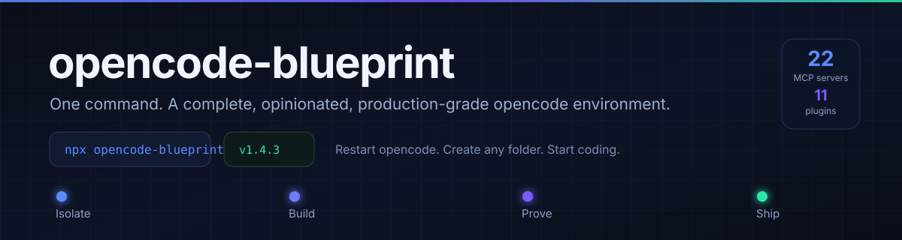
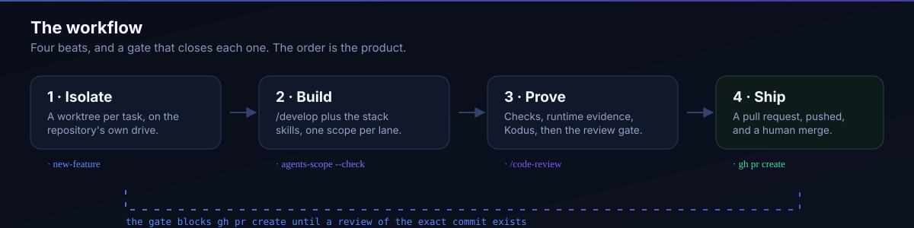

<p align="center">
  
</p>

<p align="center">
  <a href="https://www.npmjs.com/package/opencode-blueprint"></a>
  <a href="https://www.npmjs.com/package/opencode-blueprint"></a>
  <a href="https://github.com/collaby-org/opencode-blueprint/actions/workflows/ci.yml"></a>
  
  
  <a href="LICENSE"></a>
</p>

<p align="center">
  <em>One command. A complete, opinionated, production-grade
  <a href="https://opencode.ai">opencode</a> environment — with a cross-model
  review gate that blocks the pull request until a reviewer on another model
  has read the diff.</em>
</p>

```bash
npx opencode-blueprint
```

<p align="center">Restart opencode. Create any folder. Start coding.</p>

---

## What you get

<!-- stats:start -->

- **20** Vendored skills — the workflow, the standards and the mind map
- **18** Skill sources — 85 named skills, the rest whole repositories
- **22** MCP servers — in the shipped config; the GCP remotes and kubernetes wait for credentials
- **11** Plugins — local plus the slim bundle
- **3** Commands — in config/commands; three more are registered by plugins
- **1** Agents — the orchestrator
- **4** CI workflows — pinned to commit SHAs
- **14** Repo templates — the baseline every repo gets
- **v1.4.4** Version — in package.json; published on release

<!-- stats:end -->

## Why this exists

Setting up an AI coding environment used to mean weeks of trial and error:
which MCP servers, which plugins conflict, which skills are actually S-rank,
how to wire review loops so nothing sloppy ever merges. This repo is the
finished answer — researched, de-duplicated, and verified working together.

- **No conflicts.** Every orchestrator, memory, and design overlap was
  researched and resolved to a single best-of-breed pick.
- **Only proven pieces.** S-rank skills, official vendor integrations,
  high-traction community plugins.
- **A workflow with teeth.** Isolate → Build → Prove → Ship, with a Kodus
  loop gating every commit and a cross-model gate in front of every pull
  request.

## The workflow



1. **Isolate** — a fresh worktree per feature, on the repository's own drive
   (established projects; skipped for new apps and migrations); `/scope` first
   for new builds and migrations, `/audit` human-only when the context is
   stale.
2. **Build** — `/develop` plus `code-structure` and the stack skills,
   `design-system` for UI; `/architect` writes the spec first when a decision
   is owed; `/debug` anytime.
3. **Prove** — runtime evidence (before/after) and `/check verify` against the
   spec, `/test` owns the suite; then the **Kodus loop** on the staged diff,
   commit, rebase on `origin/main`, rerun the checks, and **`/code-review`**
   (cross model, confidence gated) on the final HEAD.
4. **Ship** — push the branch, open the pull request with evidence and
   `version: before → after`, `/document`, `/unslop` the prose, **PR-Agent +
   Kodus at zero** (`/sync` human-only, never auto-chained). The merge is
   yours.

Design bar: Apple-clean, invisible motion (`transform`/`opacity`, <300ms,
springs, reduced-motion honored), full UI states, dark mode from day one.

### The review gate

`/code-review` is not advice. The `opencode-code-review` plugin reads the
review artifact and **blocks `gh pr create`** until a complete review of the
exact commit exists, produced by reviewers on a different model family than
the author, at confidence ≥ 80, chunked for a 200k window, findings only. The
report lands on the pull request as one comment that updates in place. Three
escapes exist, all deliberate: a draft pull request, `enforce_pr_gate: false`
in `.opencode/review.json`, and `CODE_REVIEW_SKIP=1` for a single command.

### Running many agents without stepping on each other

The orchestrator partitions a change into work units, gives every writer one
path set, one worktree and one owner, and proves the plan before it spawns
anything:

```bash
node ~/.config/opencode/tools/agents-scope.mjs --write .agents/lanes.json   # template
node ~/.config/opencode/tools/agents-scope.mjs --check .agents/lanes.json    # conflicts
node ~/.config/opencode/tools/agents-scope.mjs --verify .agents/lanes.json --changed a.js
```

The check fails on two writing lanes claiming one path, a path outside the
repository, a dependency that does not exist, or a writer with no scope; the
verification fails when a lane changed a file it did not claim. Shared
artifacts — a type other lanes import, a schema, a generated file, a
lockfile, a migration — get one owner who lands them first, and the lanes
that depend on them run in the next wave.

## What's inside

### MCPs (22) — live access

| Area | Servers |
|---|---|
| Project & code | `notion`, `github`, `figma`, `sentry` |
| Docs & design | `context7`, `lucide-animated`, `expo` |
| Data | `supabase`, `prisma`, `postgres`, `mongodb`, `redis` |
| Cloud & infra | `gcp-bigquery`, `gcp-compute`, `gcp-gke`, `gcp-run`, `gcp-storage`, `cloudflare`, `kubernetes` |
| Payments & analytics | `stripe`, `google-analytics` |
| Reverse engineering | `rea` (pinned `rea-agents@6.5.0`; binaries, JS/Electron, .NET, APKs, firmware — needs provider tools for deep native work) |

> The local servers are pinned, never `npx`-resolved: `rea`, `prisma`,
> `postgres`, `mongodb`, `kubernetes` and `google-analytics` each install to
> `<config>/tools/<name>` and run as absolute paths (`[<node.exe>, <entry>]`),
> repointed per machine. `npx` takes whatever `node` is first on PATH (a
> machine-wide downgrade to Node 18 crashes `rea-agents@6.5.0` on `node:util`'s
> `styleText`), a cold `npx` install can race and exit 0 without ever
> handshaking, and `pipx run` rebuilds a venv on every start — which is what
> timed `google-analytics` out.

### Plugins (11) — runtime superpowers

| Plugin | Job |
|---|---|
| `oh-my-opencode-slim` | 7-agent orchestration (the one orchestrator — swarm/micode/OAC intentionally excluded) |
| `opencode-mem` (local path) | Automatic long-term memory with vector recall — local wrapper with its own complete deps (the npm cache install came out incomplete, missing `@libsql/client`) |
| `opencode-dcp` (local vendored copy) | Context pruning (pairs with memory, not against it) — vendored from `@tarquinen/opencode-dcp@3.2.0` with `` blocks relocated into `event.system` instead of rendering as chat bubbles (a `synthetic`-flag experiment was reverted after the 2.0.24 host proved to drop `synthetic` parts from model context), pending upstream [#608](https://github.com/Opencode-DCP/opencode-dynamic-context-pruning/issues/608) |
| `opencode-review` | `/review` command + `review` / `review:fixer` agents with dimension prompts (local install — not on npm; the idle auto-trigger has no v2 hook and stays unwired) |
| `opencode-code-review` (local) | Mandatory local review gate: `/code-review` command + `code-review` agent + a `gh pr create` hook that blocks until a complete cross-model review of HEAD passes |
| `opencode-telemetry` (local port) | Local cost/usage telemetry — `/telemetry-report` + `/telemetry-inspect` over a local file store (no sqlite, no npm) |
| `opencode-ralph-wiggum` (local port) | Iterative dev loops — `/ralph-loop`, `/ralph-continue`, `/cancel-ralph` (no npm) |
| `opencode-github-release` (local port) | Semantic-version GitHub releases — bump suggestion + tag/publish (no npm) |
| `envsitter-guard` (local port) | Safe `.env` inspection/mutation that never prints secrets; blocks direct `.env` reads (no npm) |
| `opencode-log-sanitizer` (local port) | Redacts secrets at the prompt/context boundary before they reach the model (no npm) |
| `opencode-command-inject` (local port) | Auto-discovers project commands (Makefile/npm/skills) — `/project-commands` (no npm) |

> Restored 2026-10-06 as local v2 ports (rows above): `opencode-telemetry`,
> `opencode-ralph-wiggum` (`/ralph-loop`), `opencode-github-release`,
> `envsitter-guard` (`.env` guard), `opencode-log-sanitizer`,
> `opencode-command-inject`. Nothing from the npm set remains removed.
>
> Ported to the opencode v2 plugin API (`Plugin.define({ id, setup })`),
> verified against the 2.0.24 host: imports use the resolvable
> `@opencode-ai/plugin/v2/promise` subpath (the bare `@opencode/plugin`
> root does not resolve in the Bun loader — first boot after install
> must be a **full** restart, killing the `opencode-cli` sidecar too,
> or failed resolutions stay negatively cached); commands register via
> add-only `editor.add` (`draft.update` does not exist on command drafts
> and disables the plugin); the installer pins the central
> `@opencode-ai/plugin@^1.19.1` fallback the loader walks up to.

> `oh-my-opencode-slim` ships with `setDefaultAgent: false`
> (`config/oh-my-opencode-slim.jsonc`, installed copy-if-missing): slim
> otherwise stamps `orchestrator` as every session's default agent, and
> during multi-project restore sessions drain before the per-directory
> agent draft is ready — host kills them with
> `Agent not found: "orchestrator"` (`Failed to drain Session`).
>
> The `orchestrator` agent is shipped as a file in `config/agents/` and
> installed to `~/.config/opencode/agents/`. V2 reads agent markdown from
> `agents/` (plural); the V1 `agent/` directory is ignored, so a file parked
> there registers nothing. The file loads with the config, before plugins, so
> the name exists when a restored session drains.

### Skills — stack knowledge

| Stack | Skills |
|---|---|
| Next.js / React | `nextjs-best-practices`, `vercel-react-best-practices`, `nextjs-nestjs-integration` |
| NestJS | `nestjs-best-practices` |
| Prisma / Postgres | `prisma-database-setup`, `prisma-client-api`, `prisma-cli`, `prisma-postgres`, `prisma-postgres-setup`, `prisma-upgrade-v7`, `prisma-mongodb-upgrade` |
| Expo mobile | `expo-overview`, `expo-router`, `expo-upgrade`, `expo-native-ui`, `expo-data-fetching`, `eas-app-stores`, `eas-workflows`, `eas-update` |
| Tauri desktop | `tauri-v2` |
| Design (all S-rank) | `apple-design`, `animate`, `animate-expo`, `animation-vocabulary`, `animation-performance`, `emil-design-eng`, `review-animations`, `improve-animations`, `find-animation-opportunities`, `pick-ui-library`, `prototype`, `design-taste-frontend`, `impeccable`, `shadcn`, `ask-sonner`, `mobile-native`, `break-ui` |
| Workflow | `new-feature`, `code-structure`, `evidence-driven-testing`, `before-and-after`, `unslop`, `perf-debug` |
| Local review gate | `code-review` (cross model, chunked, confidence gated; `code-reviewer` remains the review input skill) |
| Repository standards | `repo-standards` (the baseline every repo gets: `AGENTS.md`, `CONTRIBUTING.md`, `CLAUDE.md`, PR template, issue forms, CODEOWNERS, dependabot, SECURITY, pinned CI and a secret scan) |
| Diagrams / architecture | `diagram-design` (45 diagram types, branded HTML/SVG), `excalidraw-diagram` |
| Mind maps | `mindmap` (a Markmap `.md` in the docs home, the interactive React `.jsx` on request) |
| Video / motion output | `hyperframes` (router) + `hyperframes-core`, `hyperframes-animation`, `hyperframes-audio`, `hyperframes-cli`, `hyperframes-creative`, `hyperframes-keyframes`, `hyperframes-registry`, `hyperframes-studio`, `media-use`, `general-video`, `product-launch-video`, `faceless-explainer`, `pr-to-video` |
| Agent process / authoring | `writing-for-agents`, `domain-modeling`, `research`, `handoff`, `retro`, `grilling`, `grill-me`, `grill-with-docs`, `ask-matt` (skill router), `pr` (PR body) |
| API design / contract | `api-designer`, `graphql-architect` |
| Realtime / sockets | `websocket-engineer` |
| JS/TS | `javascript-pro`, `typescript-pro` |
| E2E / browser testing | `playwright-expert` |
| Security review / hardening | `secure-code-guardian`, `security-reviewer` |
| Legacy modernization | `legacy-modernizer` |
| Reverse-engineer a function/feature/app | `reverse-engineer-anything` (+ `rea` MCP) — plus REA companion dev skills `rea-changelog-update`, `rea-ci-tests-audit`, `rea-tool-design` |
| Adversarial review | `the-fool` |
| NestJS deep work | `nestjs-expert` |
| Next.js deep work | `nextjs-developer` |
| React UI logic | `react-expert` |
| Postgres tuning | `postgres-pro`, `database-optimizer` |
| DevOps / pipeline | `devops-engineer` |
| Test strategy / suite | `test-master` |
| Gate inputs (commands own the gate) | `code-review` → `/code-review`, `architecture-designer` → `/architect`, `feature-forge` → `/scope`, `spec-miner` → `/audit`, `debugging-wizard` → `/debug`, `code-reviewer` → review, `code-documenter` → `/document`, `fullstack-guardian` |
| Later (surface-gated) | `kubernetes-specialist`, `terraform-engineer`, `microservices-architect`, `mcp-developer`, `monitoring-expert` |

## Quickstart — new machine

```bash
npx opencode-blueprint
```

The installer: checks prerequisites → backs up your existing config →
copies `opencode.jsonc` + `AGENTS.md` + commands + `.env.example` starter →
copies all 10 local plugin trees and installs each one's deps (plus the
central `@opencode-ai/plugin` fallback the loader resolves against) →
installs every skill globally (registry via `skills add`, the workflow skills
vendored from `skills/`) → installs the Kodus CLI and `redis-mcp-server` →
installs the pinned `rea-agents`, `prisma`,
`@modelcontextprotocol/server-postgres`, `mongodb-mcp-server`,
`kubernetes-mcp-server` and `analytics-mcp` under `<config>/tools/` and
repoints each MCP at this machine's paths and newest Node >= 20.19 →
prints your personal checklist.

Every file it writes is written without a broken window: a file is staged
outside the directories the host scans and renamed over the destination in one
step, and if another process holds the destination open the install keeps the
old file rather than making it disappear.

Then:

1. `gh auth login` · `kodus auth login` (or `KODUS_TEAM_KEY`).
2. Set env vars (see `config/.env.example`). `GITHUB_TOKEN` and
   `SENTRY_ACCESS_TOKEN` are header credentials on remote servers: they belong
   in the environment that starts opencode, not in the `.env` file, which only
   feeds the wrapped local servers.
3. Restart opencode — config loads once at startup.
4. Per repo, once: `/pr-agent-setup` (scaffolds the PR-Agent Action;
   key stored as GitHub secrets, never in files).

Preview first: `npx opencode-blueprint --dry-run`.

## Windows GUI installer

Prefer Next-Next-Finish over a terminal? `installer/` holds an Inno Setup
script that wraps the same setup (`node installer/build.mjs` compiles it;
needs [Inno Setup 6](https://jrsoftware.org/isdl.php), `ISCC` env var
overrides the compiler path). It backs up existing config, deploys files
without ever uninstalling your live config, runs the pinned
`npx opencode-blueprint@<version>` for deps/skills/CLIs, and ends on a
checklist page. Unsigned build: Windows SmartScreen will ask for
confirmation on first run. The compiled
`installer/Output/opencode-blueprint-setup-<version>.exe` is intentionally
**not** committed — grab it from GitHub Releases.

## Commands (global, work in any project)

| Command | Does |
|---|---|
| `/pr-agent-setup` | Scaffolds PR-Agent Action + `.pr_agent.toml`; asks for LLM endpoint, model, key; stores secrets |
| `/pr-agent <pr>` | `/review` → fix → re-review until clean |
| `/kodus-review` | Kodus review-fix loop until no high/critical findings |
| `/code-review` | Mandatory local review gate: cross-model reviewers, chunked diff, confidence gated, blocks `gh pr create` until clean (from plugin) |
| `/ralph-loop "<task>"` | Ralph iteration loop (from plugin) |
| `/review` | On-demand code review (from plugin) |

On the PR itself you can also comment `/review`, `/improve`, or
`/ask <question>` — PR-Agent answers inline.

## Kodus: Cloud vs self-hosted

- **Cloud (default):** CLI → `api.kodus.io`, models chosen in the dashboard.
- **Self-hosted** (`kodustech/kodus-ai`, Docker): point the CLI with
  `KODUS_API_URL`, and give the backend any OpenAI-compatible model via
  `API_OPEN_AI_API_KEY` + `API_OPENAI_FORCE_BASE_URL` +
  `API_LLM_PROVIDER_MODEL`. Heads-up: it grabs ports 3000/3001/5432/27017
  (collide with local dev DBs), containers can't see host `localhost`, and
  telemetry heartbeat is on unless disabled.

## Publishing your own fork to npx

`npx <name>` resolves from the **npm registry**, so the repo must be
published as a package (that's what `package.json` + `bin` are for):

```bash
npm login                    # once per machine
npm publish --access public  # from the repo root, on every release
```

Requirements: unique `name` in `package.json`, a `bin` entry pointing at an
executable script, `npm login` done. After publishing, anyone can run
`npx <your-name>` — npx downloads the tarball to a temp dir and executes
the bin, no install needed. Version with `npm version patch|minor|major`
before each publish. Prefer scoped names (`@your-org/blueprint`) to avoid
squatting collisions — the bin name stays whatever you declare.

Nothing secret is ever published: `.gitignore` keeps `.env`, logs and session
dumps out of git (keys live in GitHub secrets and shell env, see
`config/.env.example` for the list). The npm tarball ships everything not
gitignored — including `config/plugins/**` and the vendored `skills/`, which
the installer needs — so do not put a credential in a tracked file.

## Repo layout

| Path | What |
|---|---|
| `AGENTS.md` | Global workflow (source of truth) |
| `config/opencode.jsonc` | 22 MCPs (5 GCP remotes and the local kubernetes server disabled until they have credentials) · 1 npm + 10 local plugins · instructions |
| `config/commands/` | `/pr-agent`, `/pr-agent-setup`, `/kodus-review` (plus `/code-review`, registered by the `opencode-code-review` plugin) |
| `config/agents/` | The `orchestrator` agent, installed to `~/.config/opencode/agents/` |
| `config/plugins/` | 10 local plugin trees: `opencode-review`, `opencode-code-review`, `opencode-mem` (wrapper), `opencode-dcp` (vendored 3.2.0), + 6 v2 ports (github-release, telemetry, envsitter-guard, log-sanitizer, command-inject, ralph-wiggum) |
| `skills/` | The vendored workflow skills, the `repo-standards` baseline and the `mindmap` skill (the rest come from the installer registry list) |
| `config/.env.example` | Required env vars (values never committed) |
| `bin/setup.mjs` | The installer |
| `bin/standards.mjs` | The repo-standards checker CI runs (the same script, installed globally as the `repo-standards` skill) |
| `bin/agents-scope.mjs` | The parallel dispatch check: scope conflicts, dependencies, waves, and what a lane actually changed. Installed to `~/.config/opencode/tools/agents-scope.mjs`, so it works in any project |
| `bin/readme-stats.mjs` | The numbers in this README, counted from the repository |
| `bin/clean.mjs` | Disk reclamation: report by default; `--apply` deletes package-manager caches and day-old review scratch, never the plugin tree or worktree `node_modules`. Installed to `~/.config/opencode/tools/clean.mjs` |

## Contributing

Issues and PRs welcome. Ground rules: no second orchestrators, no duplicate
memory systems, S-rank (or official) skills only, every addition named with
its conflict analysis. Run the Kodus loop + PR-Agent to zero before pushing.

## License

MIT — see [LICENSE](LICENSE).

## Acknowledgments

Workflow adapted from [michaelshimeles/skills](https://github.com/michaelshimeles/skills/blob/main/AGENTS.md).
Mind maps from [0x-man/mindmap-skill](https://github.com/0x-man/mindmap-skill) (MIT).
Design craft: [Emil Kowalski](https://github.com/emilkowalski/skills),
[Leonxlnx](https://github.com/Leonxlnx/taste-skill),
[Impeccable](https://impeccable.style), [shadcn](https://ui.shadcn.com).
Data: [Prisma](https://github.com/prisma/skills), [Expo](https://github.com/expo/skills).
Review: [Kodus](https://github.com/kodustech/cli), [PR-Agent](https://github.com/The-PR-Agent/pr-agent).
